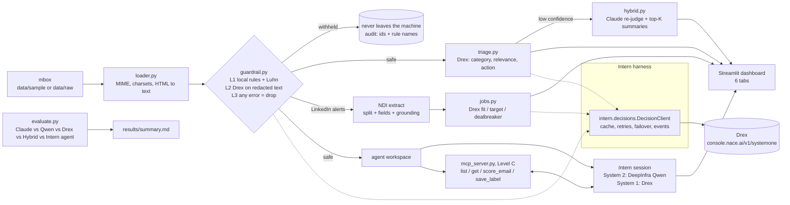

# Fossil Filter

**Drexathon · Apex Predator track.** A personalized email triage agent that takes a job usually given to a
frontier LLM (classifying and ranking every incoming email for one specific user) and gives it to **Drex**, Nace
AI's decision model. Then it measures whether that is faster, cheaper or more accurate.

> **Built with Claude Code; Intern runs inside the product.** Claude Code was our coding agent. Nace's harness
> [Intern](https://github.com/nace-ai/intern) is a runtime part of the app. Every Drex call goes through Intern's
> `intern.decisions` client (Level A). The dashboard and `scripts/run_agent.py` also launch a real Intern agent
> session, with System 2 = DeepInfra Qwen and System 1 = Drex, to triage the inbox (Level B).

| Layer | Component | Job |
|---|---|---|
| Perception | **NDI** (Nace Document Intelligence) | Splits LinkedIn job-alert emails into individual jobs, extracts fields, and grounds each value to the source |
| Decision | **Drex via Intern** (`intern.decisions.DecisionClient`) | One forward pass per email: `category` (choice), `relevance` (score), `action` (choice). Per job: `fit` (score), `is_target_role` and `has_dealbreaker` (noul). Intern supplies retries, 429 handling, failover, the answer cache, concurrency and decision events |
| Agent | **Intern agent session** (System 2 **DeepInfra** Qwen3.8-27B, System 1 Drex) | An agent triages the guardrail-passed inbox with Intern's file tools while Drex judges every turn (stuck nudges, tool-call guard, compaction) |
| Baselines and fallback | **Claude** and **DeepInfra Qwen** | The LLM baselines to beat. Claude also re-judges low-confidence Drex items (hybrid) and writes 2-sentence summaries for the top-K emails only |

## Architecture



## Setup (exact steps)

```bash
git clone git@github.com:aswin215/Fossil-Filter.git && git clone https://github.com/nace-ai/intern   # Intern next to this repo (not modified)
cd Fossil-Filter
python3.12 -m venv .venv && source .venv/bin/activate      # Intern requires Python 3.12+
pip install -e "../intern[mcp]" -r requirements.txt       # or: uv add "intern-agent[mcp] @ git+https://github.com/nace-ai/intern"
cp .env.example .env                                       # USE_MOCKS=true runs everything with no keys
python scripts/run_all.py                                  # load -> eval (5 systems) -> results/summary.md
streamlit run app.py                                       # dashboard
python -m pytest -q tests                                  # offline contract tests (no network, no keys)
```

The `intern` CLI is installed into the venv by `pip install -e ../intern`. To install it globally instead, run
`uv tool install --python 3.12 "intern-agent @ git+https://github.com/nace-ai/intern"`.

### Using real APIs
1. Fill in `.env`:
   - `NACE_API_KEY`: Drex, NDI and Intern's System 1 share one `nace_sk_...` key.
   - `DEEPINFRA_API_KEY`: Intern's System 2 and the Qwen baseline.
   - `ANTHROPIC_API_KEY` and `CLAUDE_MODEL`, for example `claude-opus-5-5`.
   - Optionally `DREX_PRICE_PER_MTOK_INPUT`. Drex costs come from the API's `usage.cost` when it is returned.
2. Set `USE_MOCKS=false`, or pass `--real`. A missing key fails fast, and the message names it.
3. `python scripts/run_all.py --real`. Predictions are cached in `results/cache/`. The Intern agent session is
   the slow, paid step; add `--skip agent` to leave it out, or run it alone with `python scripts/run_agent.py --real --limit 30`
   (add `--mcp` for Level C).
4. `intern models` lists the decision models your key can use. Set `DREX_MODEL=drex-max-v1.1` to pin one, or
   `DREX_MODEL=decisions:nace-ai/drex-max` with `OPENROUTER_API_KEY` to use OpenRouter instead.

### Using your own inbox (kept private)
**This repo is public.** Only synthetic data in `data/sample/` is committed. Your mail and labels go in gitignored paths:
1. Put your Google Takeout export at `data/raw/*.mbox`. When a file is there, `config.DATA_SOURCE` switches to `private`.
2. `python -m src.loader` writes `data/emails.jsonl`.
3. `python scripts/label_emails.py` labels emails into `data/labels.csv`. `--jobs` labels job fit into `data/job_gold.csv`.
4. Create your profile with the dashboard's onboarding form, or `python -m src.profile --name me`.

Mail access is read-only: nothing sends, deletes or modifies mail. `load_emails()` is the single source interface.

## Results

> **These numbers come from MOCK clients on the synthetic sample**, so the plumbing, UI and eval could be built
> before keys existed. The mocks are deterministic keyword heuristics with simulated latency. **They say nothing
> about Drex, Claude, Qwen or Intern.** In mock mode the Intern session is **simulated**: Intern refuses to start
> without a reachable System 1. Run `python scripts/run_all.py --real` and paste the regenerated table from
> `results/summary.md` here.

| System | Category acc | Category macro-F1 | Urgent recall | Action acc | p50 s | p95 s | emails/s | $ / 1k emails |
|---|---|---|---|---|---|---|---|---|
| Claude-only | 0.840 | 0.838 | 0.643 | 0.617 | 2.65 | 3.26 | 0.39 | 3.5062 |
| DeepInfra Qwen | 0.872 | 0.869 | 0.714 | 0.553 | 1.39 | 1.95 | 0.71 | 0.0818 |
| Drex (Level A, via Intern) | 0.819 | 0.818 | 0.643 | 0.511 | 0.20 | 0.25 | 5.25 | 0.1314 |
| Hybrid (Drex + Claude, 68% escalated) | 0.840 | 0.838 | 0.643 | 0.617 | 2.41 | 3.42 | 0.51 | 2.5142 |
| Intern agent (Level B, simulated) | 0.872 | 0.869 | 0.714 | 0.553 | 1.08 | 1.08 | 0.93 | 0.0677 |

`results/summary.md` also contains:
- speedup, cost multiple and accuracy delta vs Claude for every system
- Intern Level A stats (asks, cache hits, failures) and the Level B session table (System 1 asks by purpose, nudges, guard blocks, compactions, System 1 and System 2 tokens and cost)
- the hybrid threshold sweep
- job ranking P@5, P@10 and NDCG@10
- the guardrail benchmark
- the 3-persona personalization test

## What is measured

| Metric | How |
|---|---|
| Triage accuracy | Accuracy, macro-F1 and urgent recall for category, and accuracy for action, against `labels.csv` |
| Job ranking | P@5 and P@10 ("relevant" means gold fit = high), and NDCG@10 (gains 0/1/2), deduplicated by company + title |
| Latency | Per-call wall clock including network, p50 and p95; throughput is single-stream. For the Intern agent: session wall clock divided by emails |
| Cost | API-reported cost when returned (Drex `usage.cost` via Intern; DeepInfra `usage.estimated_cost`), else token counts × prices in `config.py`. NDI is priced per 1k pages |
| Hybrid | Escalate when the category or action top-class probability is below the threshold, or relevance is near-uniform. Swept offline over 14 thresholds |
| Personalization | The same emails under 3 profiles: agreement with labels, Spearman correlation of priority ranks, top-10 overlap |
| Guardrail | 60 synthetic sensitive and 60 benign emails, including adversarial ones (an OTP in a newsletter, a statement from a non-bank domain, a benign "statement of accomplishment") |

## How Intern is used

- **Level A ([src/clients/drex_client.py](src/clients/drex_client.py))** is a thin adapter. It turns our questions into
  `ChoiceQuestion`, `ScoreQuestion` and `NoulQuestion` and calls `DecisionClient.ask()` on a
  `DecisionsApiBackend` (console, or the OpenRouter decisions API). It runs on one background event loop, so the
  thread-pooled pipeline shares Intern's pooled HTTP client, semaphore and cache. Mock mode puts a fake
  `DecisionBackend` behind the *same* Intern client.
- **Level B ([src/agent.py](src/agent.py))** first runs the guardrail. It then copies only the safe emails, truncated,
  with the profile and label schema, into `data/agent_workspace/` (gitignored). Next it launches
  `intern -p --json --system2 deepinfra/Qwen/Qwen3.8-27B --system1 drex-latest --cwd ... --no-session --no-memory`
  and streams Intern's JSON events. The agent writes `agent_triage.json`, which is validated against our enums and
  scored like the other systems.
- **Event privacy:** the saved event log keeps only types, names, turns, timings, tokens, costs and System 1's
  probabilities. Text deltas, tool arguments, tool outputs and the final reply are dropped, and a test checks this.
  `--no-session --no-memory` stops Intern from journaling mail content in `~/.intern`.
- **Level C ([src/mcp_server.py](src/mcp_server.py))** is a stdio MCP server with `list_emails`, `get_email`,
  `score_email` (Drex probabilities through the Level A path) and `save_label`. With `--mcp` / `INTERN_USE_MCP=true`,
  `src/agent.py` writes a project-local `INTERN_HOME/config.toml` that lists it under `[[capabilities.mcp]]`, with
  declared effects. The agent then works through these tools instead of raw files, and `~/.intern` is never touched.
  A test reaches the server through Intern's own `stdio_connection` and validates the config against `McpConfig`.
- Intern is used as a dependency, unmodified. The Claude baseline is independent of Intern.

## Sensitive-data guardrail

This runs before anything leaves the machine, for triage and for the Intern agent alike.
- **Layer 1** is local: regexes for OTPs, SSNs, account and routing numbers, passwords and reset links, and tax
  forms; 13-19 digit card numbers checked with Luhn; plus sender-domain, subject-word and attachment-name lists in
  `config.py`. A hit drops the email.
- **Layer 2** asks Drex one `choice` question on *redacted* text and drops the email if P(any sensitive class) >
  `SENSITIVE_THRESHOLD`.
- **Layer 3** drops the email on any exception.

The audit log stores only ids, layers and rule names.

## Where the docs differed from the build prompt (the docs were followed)

- The base URL is `https://console.nace.ai/v1`, and Drex is `POST {base}/systemone`. Intern normalizes a `score`
  answer to 0..1 with per-level probabilities; the adapter converts it back to the expected level index.
- `drex-latest` (the console default) currently resolves to `drex-max-v1.1`.
- NDI is asynchronous (202 + job polling, or `?wait_seconds=`) and has no inline-text source, so the alert HTML is
  uploaded through an upload grant first. Unverified: the exact file-id field name in the upload response.
- Current Claude models reject `temperature`, so "temperature 0" became structured JSON output at `effort: low`.
- Drex's per-token price did not render in the docs. Intern passes through `usage.cost` when the API reports it;
  otherwise a placeholder is used, and the report flags it.

## Honest limitations

- **Mock numbers are not evidence.** In mock mode the Intern session is simulated, and its accuracy equals mock
  Qwen's because it uses the same mock labels.
- **Vendor-reported benchmarks**: Drex's and Intern's claims come from Nace. This project measures them only on this
  small set.
- **Small, single-annotator label set** (~100 emails, ~40 jobs). Confidence intervals are wide.
- **The sample labels are synthetic** and reflect only the `student_jobhunter` persona.
- **In mock mode the personalization test is weak by construction**: only relevance uses the profile.
- **Drex is weaker at knowing when *not* to act.** So the agent only labels and ranks. It never auto-deletes,
  auto-archives or replies.
- **The Intern agent sees truncated bodies** (1,500 characters) and may not label every email in its turn budget.
  Coverage is reported.
- **Known guardrail false block:** Layer 1 blocks the benign "statement of accomplishment" because of the word
  "statement". This is deliberate fail-closed behavior.

## Layout

```
config.py              env, mock flag, thresholds, prices, data source (sample vs private), guardrail lists
data/sample/           committed synthetic mbox, labels, job gold, guardrail benchmark
src/loader.py          mbox -> emails.jsonl
src/guardrail.py       3-layer fail-closed guardrail, redaction, audit log
src/clients/           drex_client.py (adapter over intern.decisions + mock backend), ndi_client.py,
                       claude_client.py, deepinfra_client.py, mock_engine.py
src/agent.py           Level B: Intern agent session, sanitized event capture, simulated mode
src/mcp_server.py      Level C: MCP server (list_emails, get_email, score_email, save_label) for the agent
src/triage.py, jobs.py, hybrid.py, baseline.py, profile.py, pipeline.py
src/evaluate.py        metrics, latency, cost, sweep, personas, guardrail bench, Intern stats, charts, summary.md
app.py                 Streamlit dashboard (Check now, Jobs, Everything else, Safety, Results, Intern agent)
scripts/               run_all.py, run_agent.py, label_emails.py, make_sample_data.py
tests/                 offline contract tests (Drex via Intern, NDI, DeepInfra, intern subprocess, event privacy,
                       MCP server via Intern's MCP client)
docs/DEMO.md           5-minute demo script
LICENSE                Apache-2.0 (matches Intern)
```
