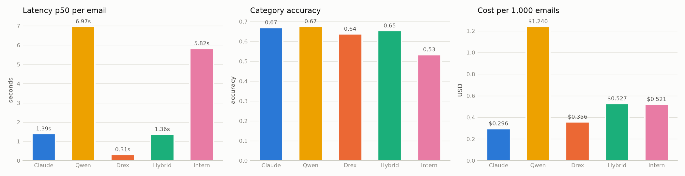

# Fossil Filter - evaluation summary

Built with Claude Code; **Intern runs inside the product**: every Drex call goes through Intern's `intern.decisions` client (Level A), and the Intern agent row is an Intern session with System 2 = DeepInfra Qwen and System 1 = Drex (Level B).

Mode: **REAL APIs** · data: `private` · Drex model: `drex-latest` · Claude model: `claude-haiku-5-5` · DeepInfra model: `Qwen/Qwen3.8-27B` · profile: `me` · labeled emails: 124 · escalation threshold: 0.7

> Drex price is a PLACEHOLDER ($0.2/M input tokens). Set `DREX_PRICE_PER_MTOK_INPUT` in .env from the Nace pricing page before quoting cost multiples.

## Headline: Claude-only vs DeepInfra Qwen vs Drex vs Hybrid vs Intern agent (email triage)

| System | Category acc | Category macro-F1 | Urgent recall | Action acc | p50 s | p95 s | emails/s | $ / 1k emails | Escalated |
|---|---|---|---|---|---|---|---|---|---|
| Claude-only | 0.669 | 0.665 | 0.500 | 0.355 | 1.39 | 2.05 | 0.73 | 0.2956 | - |
| DeepInfra Qwen | 0.675 | 0.641 | 0.333 | 0.350 | 6.97 | 25.73 | 0.10 | 1.2398 | - |
| Drex (Level A) | 0.637 | 0.566 | 0.100 | 0.339 | 0.31 | 0.50 | 3.08 | 0.3565 | - |
| Hybrid | 0.653 | 0.655 | 0.500 | 0.331 | 1.36 | 2.45 | 0.78 | 0.5270 | 0.70 |
| Intern agent (Level B) | 0.533 | 0.421 | 0.000 | 0.483 | 5.82 | 5.82 | 0.17 | 0.5207 | - |

| Comparison vs Claude-only | Speedup (p50, x) | Cost multiple (Claude / X) | Category acc delta |
|---|---|---|---|
| DeepInfra Qwen | 0.2x | 0.2x | +0.005 |
| Drex (Level A) | 4.5x | 0.8x | -0.032 |
| Hybrid | 1.0x | 0.6x | -0.016 |
| Intern agent (Level B) | 0.2x | 0.6x | -0.136 |

Intern agent latency and cost are the whole session (wall clock, System 2 + System 1) divided by emails handled, so p50 = p95.

## Intern inside the product

**Level A: Drex through `intern.decisions.DecisionClient`.** 126 asks answered (0 from Intern's cache, 0 failed attempts), backend `decisions-api:drex-latest`.

**Level B: Intern agent session** (real run): System 2 `deepinfra/Qwen/Qwen3.8-27B`, System 1 `drex-latest`. 60/60 emails labeled (100% coverage), 8 turns, 10 tool calls, stop reason `completed`.

| System 1 asks | by purpose | p50 ms | nudges | guard blocks | compactions | System 2 tokens in/out | System 2 $ | System 1 $ | wall s |
|---|---|---|---|---|---|---|---|---|---|
| 15 | {'supervise': 7, 'wrap_up': 7, 'guard': 1} | 504 | 0 | 0 | 0 | 267140/11318 | 0.0312 | 0.0000 | 349.5 |

## Hybrid threshold sweep

| threshold | category acc | action acc | urgent recall | $ / 1k | escalated | p50 s |
|---|---|---|---|---|---|---|
| 0.30 | 0.637 | 0.331 | 0.100 | 0.3598 | 0.02 | 0.31 |
| 0.35 | 0.637 | 0.331 | 0.100 | 0.3650 | 0.04 | 0.31 |
| 0.40 | 0.653 | 0.323 | 0.300 | 0.3917 | 0.14 | 0.31 |
| 0.45 | 0.653 | 0.323 | 0.300 | 0.4121 | 0.23 | 0.33 |
| 0.50 | 0.629 | 0.323 | 0.300 | 0.4451 | 0.37 | 0.36 |
| 0.55 | 0.637 | 0.331 | 0.300 | 0.4661 | 0.47 | 0.50 |
| 0.60 | 0.645 | 0.331 | 0.400 | 0.4896 | 0.56 | 1.19 |
| 0.65 | 0.645 | 0.331 | 0.400 | 0.5161 | 0.65 | 1.30 |
| 0.70 | 0.653 | 0.331 | 0.500 | 0.5270 | 0.70 | 1.36 |
| 0.75 | 0.653 | 0.355 | 0.500 | 0.5432 | 0.77 | 1.42 |
| 0.80 | 0.669 | 0.355 | 0.500 | 0.5542 | 0.81 | 1.47 |
| 0.85 | 0.669 | 0.355 | 0.500 | 0.5542 | 0.81 | 1.47 |
| 0.90 | 0.669 | 0.355 | 0.500 | 0.5594 | 0.81 | 1.50 |
| 0.95 | 0.669 | 0.355 | 0.500 | 0.5647 | 0.82 | 1.55 |

## Job ranking (LinkedIn alerts -> NDI extract -> score)

NDI: 2 alerts -> 2 jobs, p50 5.60s per alert, est. cost $0.0480.

| System | P@5 | P@10 | NDCG@10 | p50 s / job | gold-matched jobs |
|---|---|---|---|---|---|
| Claude-only | 0.00 | 0.00 | 1.000 | 1.79 | 2/2 |
| Drex (Level A) | 0.00 | 0.00 | 1.000 | 0.37 | 2/2 |
| Hybrid | 0.00 | 0.00 | 0.631 | - | 2/2 |

Cost per 1k jobs scored: Drex $0.0768, Claude $0.0872. Hybrid escalated 50%.

## Sensitive-data guardrail benchmark

60 synthetic sensitive + 60 benign emails (includes adversarial cases).

| Configuration | Recall (sensitive) | False-block rate | Missed by class |
|---|---|---|---|
| layer1_only | 0.700 | 0.100 | {'medical': 12, 'tax_or_government_id': 6} |
| drex_only | 1.000 | 0.100 | - |
| claude_only | 1.000 | 0.000 | - |
| layer1+drex | 1.000 | 0.200 | - |
| layer1+claude | 1.000 | 0.100 | - |

Semantic check latency p50/p95: Drex 0.26/0.40s vs Claude 1.30/1.98s. Cost per 1k checks: Drex $0.0384 vs Claude $0.0685.

## Personalization test (same emails, 3 profiles, Drex)

100 emails. labels.csv reflects the student_jobhunter persona; lower agreement for other personas is expected.

| Profile | Category agreement with labels | Share urgent/important | Job alerts in top 10 |
|---|---|---|---|
| student_jobhunter | 0.560 | 0.08 | 0 |
| founder | 0.600 | 0.16 | 0 |
| parent | 0.580 | 0.12 | 0 |

| Pair | Spearman of priority ranks | Top-10 overlap |
|---|---|---|
| student_jobhunter vs founder | 0.867 | 4/10 |
| student_jobhunter vs parent | 0.776 | 4/10 |
| founder vs parent | 0.918 | 6/10 |

## Notes

- Latency is per-call wall clock including network; throughput is single-stream (1 / mean latency).
- Claude baseline uses structured JSON output with low effort (current Claude models do not accept `temperature`).
- Costs come from API-reported cost when the API returns one, else token counts x prices in `config.py`.
- DeepInfra Qwen is scored with JSON mode at temperature 0 and validated against the same enums.
