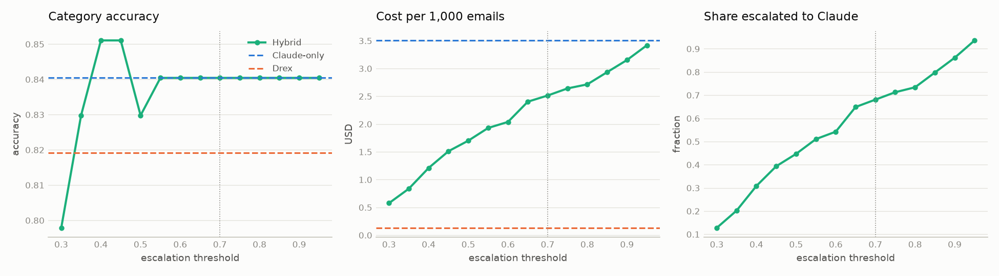

# Inbox Predator - evaluation summary

Mode: **MOCK CLIENTS (numbers are placeholders, not evidence)** · Drex model: `mock-drex` · Claude model: `mock-claude` · profile: `student_jobhunter` · labeled emails: 94 · escalation threshold: 0.7

> Drex price is a PLACEHOLDER ($0.2/M input tokens). Set `DREX_PRICE_PER_MTOK_INPUT` in .env from the Nace pricing page before quoting cost multiples.

## Headline: Claude-only vs Drex vs Hybrid (email triage)

| System | Category acc | Category macro-F1 | Urgent recall | Action acc | p50 s | p95 s | emails/s | $ / 1k emails | Escalated |
|---|---|---|---|---|---|---|---|---|---|
| Claude-only | 0.840 | 0.838 | 0.643 | 0.617 | 2.65 | 3.26 | 0.39 | 3.5062 | - |
| Drex | 0.819 | 0.818 | 0.643 | 0.511 | 0.20 | 0.25 | 5.25 | 0.1314 | - |
| Hybrid | 0.840 | 0.838 | 0.643 | 0.617 | 2.41 | 3.42 | 0.51 | 2.5142 | 0.68 |

| Comparison | Speedup (p50, x) | Cost multiple (Claude / X) | Category acc delta vs Claude |
|---|---|---|---|
| Drex | 13.3x | 26.7x | -0.021 |
| Hybrid | 1.1x | 1.4x | +0.000 |

## Hybrid threshold sweep

| threshold | category acc | action acc | urgent recall | $ / 1k | escalated | p50 s |
|---|---|---|---|---|---|---|
| 0.30 | 0.798 | 0.553 | 0.571 | 0.5766 | 0.13 | 0.21 |
| 0.35 | 0.830 | 0.564 | 0.571 | 0.8370 | 0.20 | 0.21 |
| 0.40 | 0.851 | 0.606 | 0.571 | 1.2107 | 0.31 | 0.22 |
| 0.45 | 0.851 | 0.617 | 0.571 | 1.5119 | 0.39 | 0.23 |
| 0.50 | 0.830 | 0.606 | 0.571 | 1.7019 | 0.45 | 0.24 |
| 0.55 | 0.840 | 0.628 | 0.643 | 1.9305 | 0.51 | 1.75 |
| 0.60 | 0.840 | 0.617 | 0.643 | 2.0393 | 0.54 | 1.96 |
| 0.65 | 0.840 | 0.617 | 0.643 | 2.4035 | 0.65 | 2.34 |
| 0.70 | 0.840 | 0.617 | 0.643 | 2.5142 | 0.68 | 2.41 |
| 0.75 | 0.840 | 0.617 | 0.643 | 2.6419 | 0.71 | 2.45 |
| 0.80 | 0.840 | 0.617 | 0.643 | 2.7154 | 0.73 | 2.51 |
| 0.85 | 0.840 | 0.617 | 0.643 | 2.9354 | 0.80 | 2.67 |
| 0.90 | 0.840 | 0.617 | 0.643 | 3.1534 | 0.86 | 2.72 |
| 0.95 | 0.840 | 0.617 | 0.643 | 3.4182 | 0.94 | 2.81 |

## Notes

- Latency is per-call wall clock including network; throughput is single-stream (1 / mean latency).
- Claude baseline uses structured JSON output with low effort (current Claude models do not accept `temperature`).
- Costs come from token counts x prices in `config.py`.
